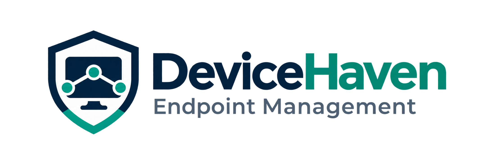

<p align="center">
  
</p>

<p align="center"><em>Every Device. One Platform.</em></p>

DeviceHaven is free, self-hosted endpoint management for Windows. Install it like
any other program, and manage your PCs from a clean web dashboard. Everything stays
on your own network: there is no cloud service, no account and no tracking.

> **Status: early development (v0.1, stage 1 of 4).** Not ready for production use yet.

## What works today

- **Server** (Windows service): HTTPS with its own certificate, made on first start.
- **One-time enrolment codes**: single use, expire after 1–168 hours, stored only as hashes.
- **Agent** (Windows service): enrols once, then checks in on a schedule the server sets.
- **Inventory**: hardware, serial number, Windows version and build, disks and BitLocker status, logged-on user, and installed programs.
- **Settings you control**: check-in from every 30 seconds to once a day, plus inventory frequency and random spread so PCs don't all check in at once.
- **Audit log** that can only be added to, never edited or deleted.

## Coming next

| Stage | What you get |
|---|---|
| 1 (in progress) | Installers (.exe for the server, .msi for the agent), web dashboard, admin sign-in with two-step verification, tray app |
| 2 | Software deployment (winget catalog) and Windows patching |
| 3 | Policies, remote tools and remote help |
| 4 | Imaging: image library, drivers, USB then network (PXE) boot |

## How it connects

```
 Tray app  ──(local only)──  Agent service  ──(outbound HTTPS, pinned)──▶  DeviceHaven Server  ◀── your browser
 (no admin rights)           (runs as SYSTEM)                              (Windows service + database)
```

- The agent always connects **out** to the server, so you don't need to open firewall ports on your PCs.
- The agent only trusts the one server certificate it was installed with (its SHA-256 fingerprint), so a fake server on the network can't take over enrolled PCs.
- See [docs/SECURITY.md](docs/SECURITY.md) for the full security design.

## Requirements

| | Needs |
|---|---|
| Server | 64-bit Windows 10/11 or Windows Server 2019+. Nothing else: .NET and the database are bundled. |
| Agent | 64-bit Windows 10/11. Nothing else. |
| Imaging (stage 4) | Microsoft's free Windows ADK and WinPE add-on. |

## Trying the current build

Until the installers are ready, each push to `main` produces Windows builds under
**Actions → latest run → Artifacts**:

1. **Server**: on the server PC, from an admin prompt:
   ```powershell
   sc.exe create "DeviceHaven Server" binPath= "C:\DeviceHaven\Server\DeviceHaven.Server.exe" start= auto
   sc.exe start "DeviceHaven Server"
   ```
   Allow TCP 8443 in Windows Firewall. Then, on the server, create an enrolment code:
   ```powershell
   Invoke-RestMethod -Method Post -Uri https://localhost:8443/api/admin/enrollment-codes `
     -ContentType application/json -Body '{"validHours":24}' -SkipCertificateCheck
   ```
   It returns the code, the server's fingerprint and the install command.
2. **Agent**: on each PC, from an admin prompt:
   ```powershell
   C:\DeviceHaven\Agent\DeviceHaven.Agent.exe configure --server https://YOUR-SERVER:8443 --fingerprint <fingerprint> --code <code>
   sc.exe create "DeviceHaven Agent" binPath= "C:\DeviceHaven\Agent\DeviceHaven.Agent.exe" start= auto
   sc.exe start "DeviceHaven Agent"
   ```
3. On the server, list enrolled PCs: `Invoke-RestMethod https://localhost:8443/api/admin/devices -SkipCertificateCheck`

Until admin sign-in is built, the admin API only answers requests made on the server itself.

## Building from source

Needs the .NET 10 SDK.

```powershell
dotnet build DeviceHaven.slnx
dotnet test DeviceHaven.slnx
```

## Project layout

```
src/DeviceHaven.Shared   Protocol messages and certificate pinning, shared by server and agent
src/DeviceHaven.Server   ASP.NET Core server, SQLite database, admin and agent APIs
src/DeviceHaven.Agent    Windows service: enrolment, check-in, inventory
tests/                   Security and end-to-end tests (real agent loop against real server)
assets/                  Brand artwork and Windows icons
```

## Licence

To be decided before the first public release.
