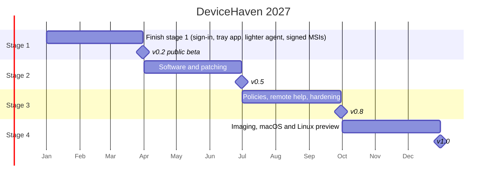

# DeviceHaven 2027 Roadmap

*Every Device. One Platform.* · Last updated November 2026

The 2027 goal is **DeviceHaven 1.0 in December 2027**: a free, self-hosted tool that installs,
patches, configures and images Windows PCs, with macOS and Linux agents in preview. It gets
there through four quarterly releases, one per stage, with smaller releases every month in between.

Dates are targets, not promises. The [risks](#risks-open-decisions-and-targets) section says what
moves first if time runs short.

## The year at a glance

## Where we are (November 2026)

Stage 1 is about half done:

- Server and agent MSIs with silent switches, tested on a real Windows install every build
- Web console with devices, inventory, enrolment codes, agent settings and the audit log
- Secure enrolment: pinned certificate, one-time or batch codes, hashed tokens, locked-down data folders
- Inventory: hardware, Windows build, disks, BitLocker status and installed programs

## Q1 (January to March): finish stage 1, public beta

Q1 ends with **version 0.2, the first public beta**, published as signed MSIs.

| Work | What it gives you | Target |
| --- | --- | --- |
| Admin sign-in with two-step verification (TOTP) and roles (Admin, Read-only) | The console works from any PC on your network, not only the server | January |
| Device groups and tags | Different settings for different PCs, and the base for every later stage | January |
| Tray app | Status icon by the clock, a Get help button, and restart prompts | February |
| Lighter agent (Native AOT, direct Windows calls instead of WMI) | Agent memory from about 58 MB down to under 25 MB, and a smaller MSI | February to March |
| Live connection | Commands reach a PC in about a second, not at the next check-in | March |
| Server backup and one-click restore | A failed server disk doesn't lose your device list | March |
| Code-signed MSIs and programs | No Windows SmartScreen warning when installing | March |
| Licence chosen, README and user guide | Ready for other people to try | March |

**Beta gate:** two weeks on five test PCs with no lost data, no agent crashes, and upgrades from 0.1 that keep every enrolment.

## Q2 (April to June): software and patching

Q2 ends with **version 0.5**: DeviceHaven installs, updates and patches software on every PC.

| Work | What it gives you | Target |
| --- | --- | --- |
| Job engine: queue, retries, results and logs for each PC | Every action is tracked, and failed ones retry on their own | April |
| App catalog built on winget | Install Chrome, 7-Zip, Teams and thousands more with one click | April |
| Your own packages (MSI or EXE with silent switches) uploaded to the server | Deploy line-of-business apps the catalog doesn't have | April |
| Self-service app store in the tray | Users install approved apps themselves, with no admin rights | May |
| Automatic third-party app updates | Old browsers and readers patched without you lifting a finger | May |
| Script library (PowerShell) with saved output for each PC | Run a fix on one PC or many, and see what happened | May |
| Windows Update control: scan, approve, schedule, defer, restart windows | Patching on your terms, with no surprise restarts during work | May to June |
| Download speed limits and local caching | Patch Tuesday doesn't swamp the internet connection | June |
| Reports: patch compliance and software inventory (CSV and PDF) | Proof for clients or insurers that PCs are up to date | June |

## Q3 (July to September): policies, remote help and hardening

Q3 ends with **version 0.8**: PCs are configured and kept secure from the console, you can help
users remotely, and the security design is complete ahead of an outside review.

| Work | What it gives you | Target |
| --- | --- | --- |
| Policy profiles: security baseline, firewall, power, screen lock, local accounts | Set a PC's settings once, and they stay set | July |
| Rotating local admin passwords (like Microsoft LAPS) | Every PC has its own admin password, readable only in the console | July |
| BitLocker enforcement, with recovery keys stored on your server | Encrypted drives, and keys you can find when someone is locked out | July |
| Security score per PC with one-click fixes | See at a glance which PCs are at risk and fix them | August |
| Remote tools: processes, services, event log, files, command prompt | Fix most problems without interrupting the user | August |
| Remote screen sessions with the user's approval and a visible notice | Hands-on help, without a third-party remote tool | August to September |
| Alerts by email or webhook (Teams, Discord, Home Assistant) | Hear about a full disk, failing drive or offline PC before users do | September |
| Security hardening: mutual TLS, signed commands, encrypted database, low-privilege server account | Closes every remaining item on the security plan | September |
| Signed automatic updates for the server and agents | New versions roll out safely with no manual installs | September |

**Security gate:** an outside security review booked in September, so its findings are fixed before 1.0.

## Q4 (October to December): imaging, macOS and Linux, and 1.0

Q4 ends with **version 1.0 in December**: a fresh PC goes from bare metal to fully set up with no
hands-on steps, and macOS and Linux agents are available as a preview.

| Work | What it gives you | Target |
| --- | --- | --- |
| Image library: import a Windows 11 ISO and customise it offline (settings, debloat, apps) | Your own clean images, with no scripts left to run after imaging | October |
| Driver library by PC model | The right drivers added at install time automatically | October |
| USB boot media builder (WinPE) | Image any PC from a USB stick | October |
| Network (PXE) boot | Image PCs over the network with no USB at all | November |
| Zero-touch: imaged PCs enrol themselves and get their apps and policies | Bare metal to ready-to-use, untouched | November |
| macOS agent preview (.pkg): check-in and inventory | Macs show up in the same console | November to December |
| Linux agent preview (.deb and .rpm): check-in and inventory | Linux PCs and servers show up too | November to December |
| Server on Linux or Docker (preview) | Run DeviceHaven on a homelab box instead of Windows | December |
| 1.0 release: security review fixes, full user and admin guide, upgrade guarantee | A version people can trust for the long term | December |

Imaging needs Microsoft's free Windows ADK and WinPE add-on. Setup will offer to download them,
since Microsoft generally doesn't allow them to be bundled.

## All year: security, quality and community

- **Monthly releases** on the [Releases page](https://github.com/TechTimCA/DeviceHaven/releases), each with signed MSIs and a plain-English changelog
- **Every build installs for real**: silent install, enrolment, upgrade from the previous version and uninstall, on a clean Windows machine
- **Performance budget** checked every build: agent memory, CPU while idle, and MSI size
- **Security upkeep**: dependency updates every month, a private way to report problems, and fixes for security issues released within a week
- **Documentation** that grows with each feature: a user guide, an admin guide and an upgrade guide
- **Community**: GitHub Discussions for questions, issue templates, and a public roadmap people can vote on

## Risks, open decisions and targets

The biggest risk is time: this is a year of work for one part-time developer. If the year runs
short, the macOS and Linux previews move to 2028 first, then network (PXE) boot, so that 1.0 still
ships with USB imaging.

**Other risks**

- **Remote screen sessions are hard to build well.** Fallback: build on the open-source RustDesk engine, after checking its licence.
- **Trust.** Nobody installs an unknown agent with admin rights without a reason to. The outside security review, code signing and open source are the answer, so they are not optional.
- **Costs.** Code signing and a security review cost money each year, and need a budget before March and September.

**Open decisions**

- [ ] Licence: AGPL (copies must stay open) or MIT/Apache (anyone can reuse it, even in paid products)
- [ ] Domain name and website, after the trademark and domain checks
- [ ] Whether to offer paid support or hosting later, with the software itself staying free

**Targets for 1.0**

| Measure | Today | 1.0 target |
| --- | --- | --- |
| Agent memory while idle | about 58 MB | under 25 MB |
| Agent MSI size | 27 MB | under 15 MB |
| Install tests passing on every build | 100% | 100% |
| Time from bare metal to a ready PC | not possible yet | under 30 minutes |
